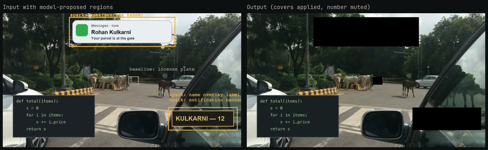
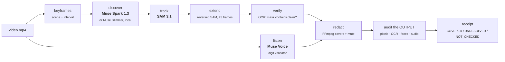

<div align="center">

# Veil

### Find what in *your* video could identify you, before you post it.

Muse Spark proposes what identifies **this** creator. SAM 3.1 tracks it. Muse Voice hears the spoken phone number.<br/>
Deterministic code redacts, **re-checks the exported file**, and tells you exactly what it could not clear.

**Models propose. Code decides.**

[](#run-the-tests)
[](veil/pyproject.toml)
[](#the-meta-models-and-what-each-one-does)
[](SUBMISSION.md)
[](LICENSE)

[**Demo video**](#demo-video) · [**Results**](#results) · [**Quickstart**](#quickstart) · [**How it works**](#how-it-works) · [**Limitations**](#honest-limitations)



<sub>Left: the input, with regions Muse Spark proposed and SAM 3.1 tracked. Right: Veil's exported file. Fictional data on licensed street footage.</sub>

</div>

---

## The problem

A creator films their street. In 25 seconds the clip shows a **delivery notification with their full name**, a **door plate with their surname and flat number**, a **society board**, and they **say their phone number out loud in Hindi**.

Redaction tools look for a fixed list: faces, license plates, screens, documents. On our held-out clips that list found **0 of 4** planted identity leaks, because none of them is a face or a plate. What identifies a person depends on the video. Even when something *is* covered, nobody checks the exported file.

## What Veil does

<table>
<tr>
<td width="33%" valign="top">

**1 · Discover (open vocabulary)**<br/>
Muse Spark looks at keyframes and proposes *what in this video* could identify the creator, each with a written reason ("Displays full personal name Rohan Kulkarni in a Messages notification").

</td>
<td width="33%" valign="top">

**2 · Track, listen, redact**<br/>
SAM 3.1 turns each proposal into masks tracked through every frame. Muse Voice Transcribe hears spoken digits (Hindi/English). FFmpeg covers the masks and mutes the number.

</td>
<td width="33%" valign="top">

**3 · Verify the export**<br/>
Code decodes the **output** file and checks that covers are really there, OCR finds no readable text, a face detector stays quiet, and re-transcription finds no digit run. Every finding ends as `COVERED`, `UNRESOLVED` or `NOT_CHECKED`, never "safe".

</td>
</tr>
</table>

<div align="center">

</div>

## Results

All numbers below are reproducible from committed artifacts (`gate/`, `eval/results/`). The held-out clips are **composited** (licensed street footage plus fictional graphics plus Hindi text-to-speech), which is easier than real phone footage. Read [EVALUATION.md](EVALUATION.md) for the full method.

### Open vocabulary beats a fixed list

| Held-out clips c1–c3 | Planted visual leaks found |
|---|---|
| Fixed baseline: face, plate, phone screen, paper document | **0 / 4** |
| Baseline + Muse Spark proposals | **3 / 4** (missed: a delivery-box address label) |

<sub>Source: `eval/results/final/heldout_results.md`.</sub>

### We pre-registered a pass/fail gate, and it failed

The thresholds were frozen in [`gate/GATE.md`](gate/GATE.md) **before** any model ran on the gate clips. The frozen verdict is **FAIL** and stays FAIL. Everything after it is labelled *post-gate*.

| Criterion | Frozen run (`4ef8de9`) | Post-gate fixes, capped run |
|---|---|---|
| G1 discovery (≥3/4 leaks) | ✅ PASS 3/4 | ✅ PASS 3/4 |
| G2 false flags (≤1/3 safe controls) | ❌ FAIL 2/3 | ✅ PASS 1/3 |
| G3 tracking (≥95% of frames) | ✅ PASS 100% | ✅ PASS 100% |
| G4a spoken-number detection | ✅ PASS | ✅ PASS |
| G4b mute window (100% coverage, ≤2.5 s over) | ❌ FAIL 3.13 s over | ❌ FAIL 2.85 s over |
| **Verdict** | **FAIL** | **FAIL** |

<!--REPEATS-->

### Veil catches its own models' mistakes

SAM 3.1 grounded Spark's "name overlay label" on a **block of code**. The post-gate mask check runs local OCR inside every mask that claims specific text, and it removed that mask before redaction:

<div align="center"></div>

### It says what it could not clear

<div align="center"></div>

### Spoken numbers, in Hindi

<div align="center"></div>

The number was muted and re-transcription of the output found no digit run. But Voice misheard digits ("987765 · 5432100" for 98765 43210), and the mute window is still wider than our own limit (G4b FAIL).

<!--GLIMMER-->

## The Meta models, and what each one does

| Model | Role in Veil | What deterministic code checks afterwards |
|---|---|---|
| **Muse Spark 1.3** (`/v1/responses`, strict JSON schema) | Open-vocabulary discovery: per keyframe, proposes identifying things with a reason and a SAM prompt | JSON schema validation; proposals are merged by fuzzy match; only a mask that exists in the video counts |
| **SAM 3.1** (hosted video input) | Turns each proposal into masks tracked through the whole clip; reversed tracking fixes late track starts | Gap check inside each track; OCR mask-vs-claim check; covers verified pixel by pixel in the decoded output |
| **Muse Voice Transcribe 1.0** (`/v1/asr/transcribe`) | Hears spoken digits in Hindi, English or Hinglish, in 2 s windows | Digit-run validator (≥6 digits from ≥4 digit tokens); output audio silent in muted spans; re-transcription of the output |
| **Muse Glimmer 30B** (open weights, local llama.cpp) | Discovery without uploading frames (see above) | Same schema and scorer as Spark |

Removing any model removes a capability: without Spark, 0/4 leaks are found; without SAM nothing is tracked; without Voice the spoken number goes out unmuted.

<!--COSTS-->

## How it works



* Every stage writes `runs/<id>/<stage>.json`, validated by a pydantic model ([`schemas.py`](veil/src/veil/schemas.py)). Stages read artifacts, never each other's memory, so any stage can be re-run on its own.
* Every model call is reserved in `calls.json` with model, endpoint, latency, usage and estimated cost. Retries are explicit, named (`-retryN`) and listed in the run notes.
* Ground truth (`gate/labels/`) is read only by the scorer, never by inference.

## Quickstart

**Requirements:** macOS or Linux, Python 3.12, [uv](https://docs.astral.sh/uv/), FFmpeg/ffprobe on `PATH`, Node 22+ (web UI only), and a Meta Model API key. Local OCR uses macOS Vision; elsewhere that check reports `NOT_CHECKED`.

```bash
git clone https://github.com/thecodekaizen/veil.git && cd veil
uv sync --project veil --extra test            # Python deps
echo "MODEL_API_KEY=sk-..." > .env             # gitignored; never committed
make test                                      # 119 tests, no network
```

### Audit a video

```bash
uv run --project veil veil run my_clip.mp4 --run-id demo \
  --stages keyframes,discover,track,extend,verify,listen,redact,audit,report
open runs/demo/receipt.html                    # the receipt
open runs/demo/output.mp4                      # the redacted export
```

The command prints the concept table, the spoken digits and every finding with its status. Optional switches:

| Environment variable | Effect |
|---|---|
| `VEIL_SPARK_CAP=50` | Track up to 50 Spark concepts (default 10 is the frozen gate setting) |
| `VEIL_SAM_RETRIES=2` | Retry a failed SAM call up to twice; each retry is logged |
| `VEIL_DISCOVER=glimmer` | Use open-weight Muse Glimmer on a local `llama-server` instead of hosted Spark |

### Open the review desk

```bash
uv run --project veil veil export-web demo --provenance "my own clip, consented"
cd veil/web && npm install && npm run build && npx vite preview --port 4173
# http://localhost:4173/?run=demo
```

<details>
<summary><b>Run discovery fully locally with Muse Glimmer (open weights)</b></summary>

```bash
brew install llama.cpp
hf download unsloth/Muse-Glimmer-30B-GGUF Muse-Glimmer-30B-UD-Q3_K_XL.gguf mmproj-kquant.gguf --local-dir ~/models/glimmer
llama-server -m ~/models/glimmer/Muse-Glimmer-30B-UD-Q3_K_XL.gguf \
  --mmproj ~/models/glimmer/mmproj-kquant.gguf -c 8192 -ngl 99 --port 8088
VEIL_DISCOVER=glimmer uv run --project veil veil run my_clip.mp4 --run-id local --stages keyframes,discover
```
Keyframes stay on your machine for this stage. Tracking (SAM 3.1) and listening (Muse Voice) still use the hosted API.
</details>

## Reproduce the evaluation

```bash
make gate     # score the frozen gate from runs/c1..c3  ->  gate/GATE_RESULT.md
make eval     # dev (synthetic) and held-out results  ->  eval/results/final/
uv run --project veil python -m gate.score_gate --runs runs-postgate --out gate/postgate   # post-gate
```

The gate clips are generated by `gate/make_composite_clips.py` from licensed Wikimedia Commons footage (sources and hashes in [`gate/exploratory/SOURCES.md`](gate/exploratory/SOURCES.md)). Labels are written by the same script and were committed before any model run.

## Demo video

`demo/` holds the full, reproducible pipeline for the submission video: a Remotion composition, Playwright captures of the real UI, a word-timed caption map, and loudness QA. See [`demo/out/README.md`](demo/out/README.md) for what is real and what is typeset. The voiceover is a **synthetic clone of the author's own voice** (Chatterbox, watermarked), recorded that way because of construction noise. It is disclosed in the video.

## Repository map

```
veil/src/veil/        engine: stages/, validators/, verification/, providers/, schemas.py, runner.py, cli.py
veil/web/             review desk (React + Vite), reads exported run manifests
veil/tests/           119 unit tests (recorded fixtures, no network)
gate/                 pre-registered gate, labels, scorer, frozen + post-gate results
eval/                 dev vs held-out evaluation
demo/                 demo-video pipeline (voice, captures, Remotion, QA)
docs/                 decisions log, API notes, media
archive/              superseded THREAD/SHOWME prototypes (not part of the submission)
```

## Honest limitations

* **The pre-registered gate failed.** Post-gate fixes were designed after seeing the failures and run on the same clips, so they are not an untouched evaluation.
* **Composited clips and TTS audio** make detection easier than real phone footage. There has been no real-user study.
* **Open vocabulary cuts both ways.** Lifting the 10-concept cap made Spark flag a product logo, so G2 failed again (`gate/postgate2`).
* **Audio timing is coarse.** Voice returns turn-level timing, so mute windows are wide. A voiced-time refinement once *under*-covered the number; it stays opt-in.
* **Sampled checks.** OCR at 2 fps and the face detector every 5th frame; anything between samples is not examined. Local OCR is macOS-only.
* **Cloud processing.** Frames, video and audio are sent to Meta's API (except with Glimmer discovery). Veil is not a privacy guarantee and never says a video is "safe".

## Built during the hackathon

All Veil code dates from commit `610a395` (2026-10-28) onward, within the Oct 27 – Nov 4 build window. The repository started on 2026-10-25 with docs and experiments for an earlier idea (THREAD); those are kept in `archive/`, are not imported by Veil, and git history has not been rewritten. Decisions are logged in [`docs/decisions.md`](docs/decisions.md).

## Data, media and licences

* Code: [MIT](LICENSE).
* Street footage in `docs/media` and in the demo video: *Moving vehicles in Link road, Cuttack* by Subhashish Panigrahi and *Stray Cattle in Lutyens Delhi* by Fowler&fowler, Wikimedia Commons, **CC BY-SA 3.0**, composited with fictional graphics. Derived media are shared under CC BY-SA 3.0 ([NOTICE](NOTICE.md)).
* All names, numbers and addresses are fictional ("Rohan Kulkarni", "98765 43210").

<div align="center"><sub>Built solo for the Meta Global AI Developer Hackathon 2026 · Indie track</sub></div>
