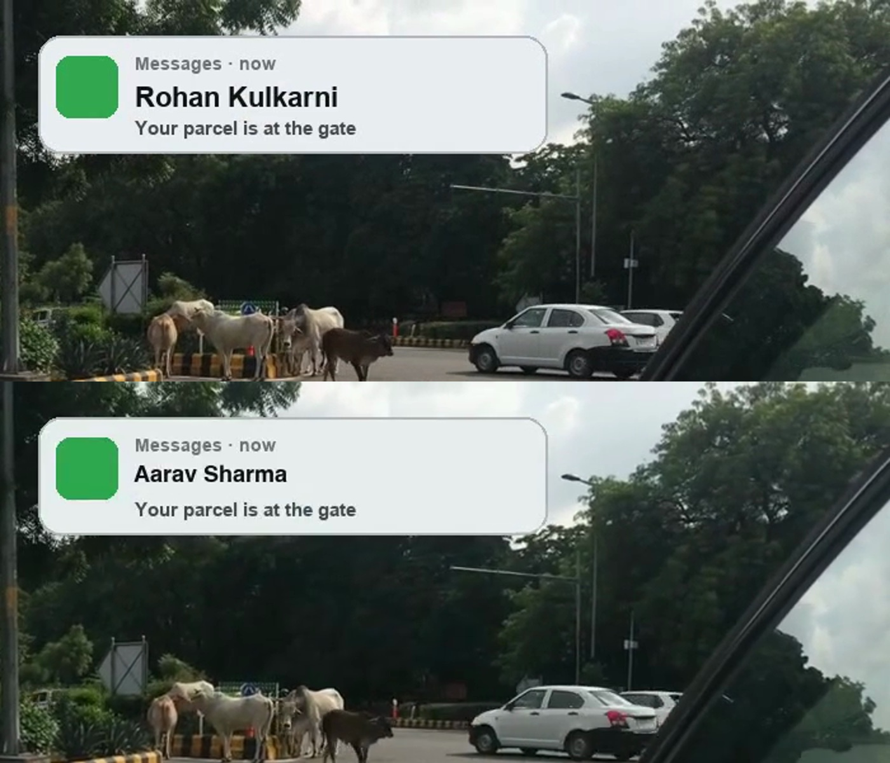
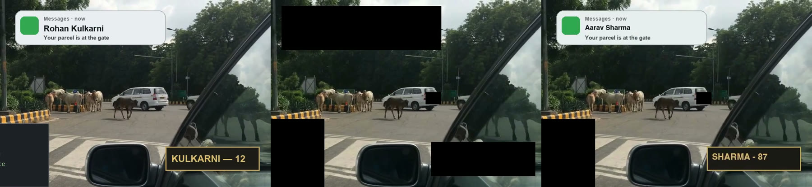
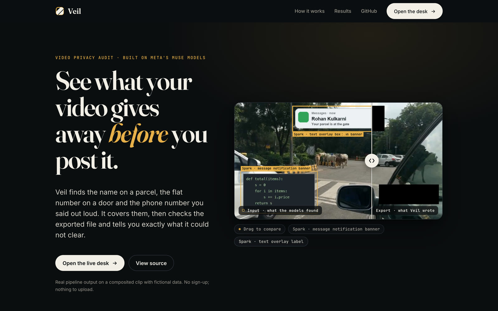
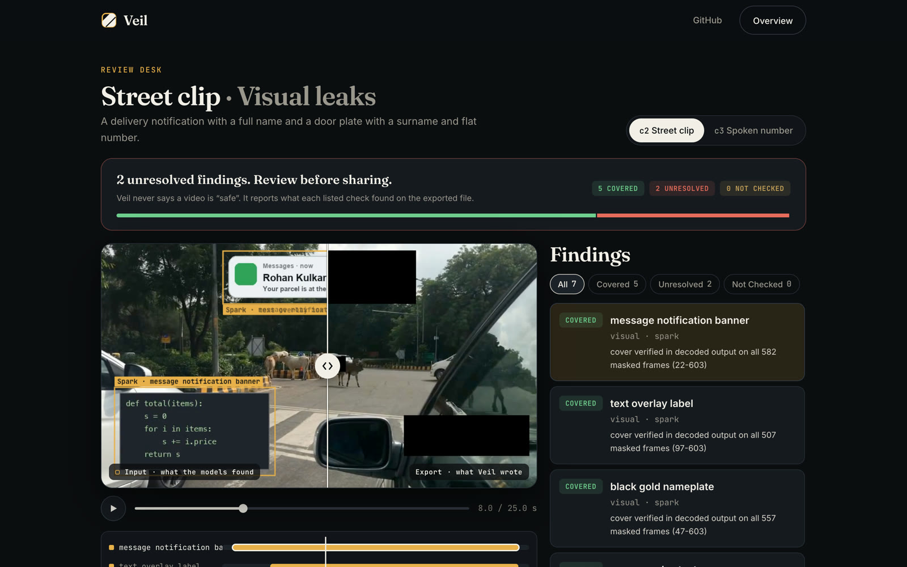
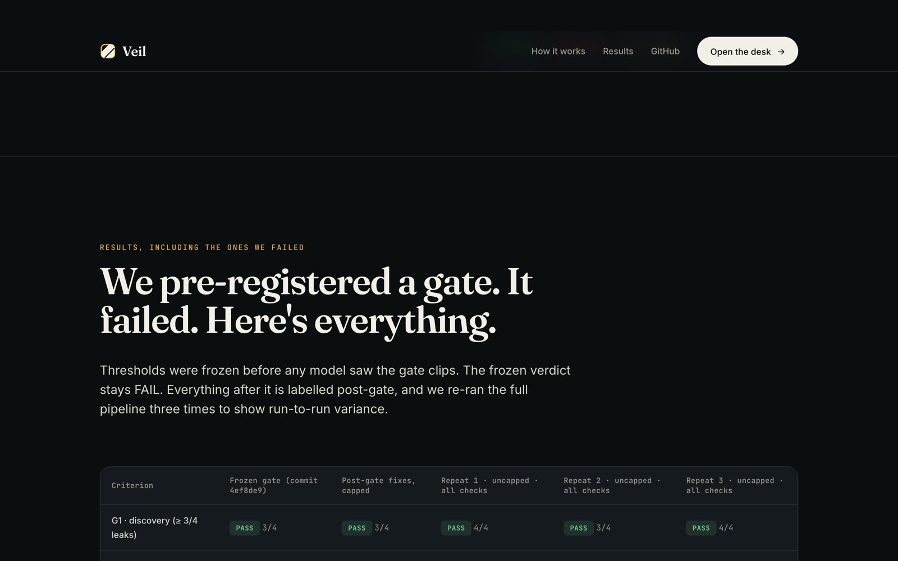
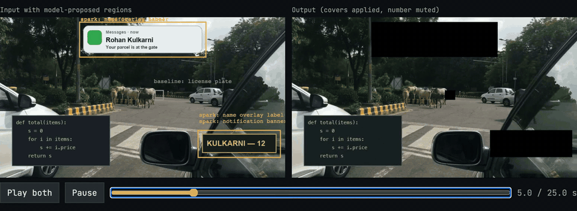
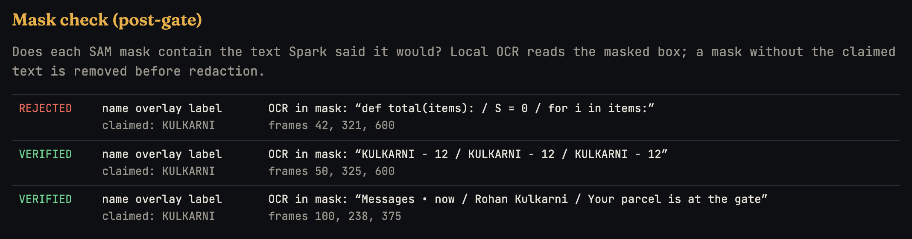
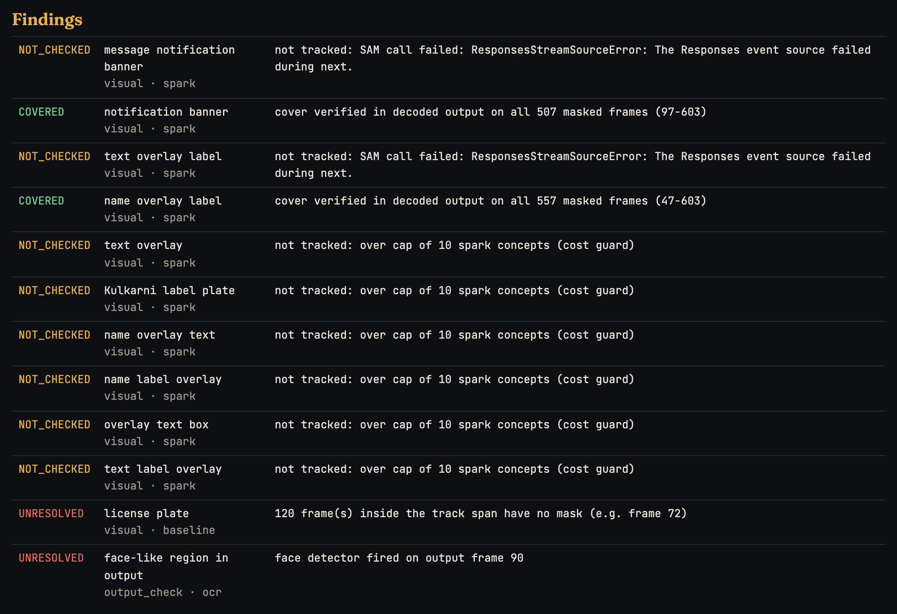
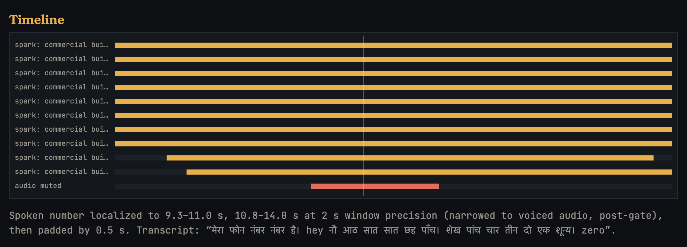
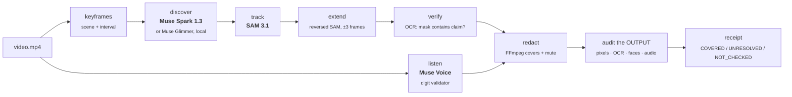

<div align="center">

# Veil

### Find what in *your* video could identify you, before you post it.

Muse Spark proposes what identifies **this** creator. SAM 3.1 tracks it. Muse Voice hears the spoken phone number.<br/>
Then Veil fixes it **naturally**: no black boxes. Verified text is re-rendered with fictional values, so the shot still looks real.<br/>
Deterministic code **re-audits the exported file** and tells you exactly what it could not clear.

**Models propose. Code decides.**

[](#run-the-tests)
[](veil/pyproject.toml)
[](#the-meta-models-and-what-each-one-does)
[](SUBMISSION.md)
[](LICENSE)
[](#how-veil-uses-metas-open-weights-muse-glimmer)

[**Live demo**](https://thecodekaizen.github.io/veil/) · [**▶ Demo video (2:05)**](https://thecodekaizen.github.io/veil/video/veil-demo.mp4) · [**Results**](#results) · [**Quickstart**](#quickstart) · [**How it works**](#how-it-works) · [**Limitations**](#honest-limitations)

<a href="https://thecodekaizen.github.io/veil/video/veil-demo.mp4"></a>
<sub>Same frame, cropped. Top: input. Bottom: Veil's natural export, with no black box. The name is re-rendered with a fictional value in the same style. <b>▶ <a href="https://thecodekaizen.github.io/veil/video/veil-demo.mp4">Watch the 2-minute demo</a></b> (AI narration by Kokoro, original music). In the full frame, regions with no verified text, such as a code panel, stay covered.</sub>



<sub>Left: input. Middle: black-box export. Right: <b>natural export</b>, where "Rohan Kulkarni" becomes "Aarav Sharma" and the plate text is re-rendered in the original style. The natural file gets its own OCR audit (0 original words in 53 frames). Regions without verified text, like the code panel, stay covered. Fictional data on licensed street footage. <a href="#or-skip-the-black-boxes-natural-export">Details</a></sub>

</div>

---

## Try it live: [thecodekaizen.github.io/veil](https://thecodekaizen.github.io/veil/)

No sign-up and nothing to upload. The site shows **real pipeline output** (end-to-end repeat r1, every check run) on composited clips with fictional data.

<table>
<tr>
<td width="50%" valign="top">
<a href="https://thecodekaizen.github.io/veil/"></a>
<p><b>Landing page.</b> The hero opens on the **natural export**: drag the divider across the real input (left, with the regions the models proposed) and Veil's natural file (right), or flip the toggle to the black-box covers. Below: the problem, how it works, a real receipt, the full gate table and the call ledger.</p>
</td>
<td width="50%" valign="top">
<a href="https://thecodekaizen.github.io/veil/#/desk?run=c2"></a>
<p><b>Review desk.</b> A verdict banner (5 COVERED · 2 UNRESOLVED · 0 NOT_CHECKED), frame-synced input/export, clickable tracks, and findings that highlight their region. The box on the code panel is a real false flag (gate G2), shown, not hidden.</p>
</td>
</tr>
</table>

<div align="center"><a href="https://thecodekaizen.github.io/veil/#results"></a></div>

## The problem

A creator films their street. In 25 seconds the clip shows a **delivery notification with their full name**, a **door plate with their surname and flat number**, a **society board**, and they **say their phone number out loud in Hindi**.

Redaction tools look for a fixed list: faces, license plates, screens, documents. On our held-out clips that list found **0 of 4** planted identity leaks, because none of them is a face or a plate. What identifies a person depends on the video. Even when something *is* covered, nobody checks the exported file.

## What Veil does

<table>
<tr>
<td width="33%" valign="top">

**1 · Discover (open vocabulary)**<br/>
Muse Spark looks at keyframes and proposes *what in this video* could identify the creator, each with a written reason ("Displays full personal name Rohan Kulkarni in a Messages notification").

</td>
<td width="33%" valign="top">

**2 · Track, listen, redact**<br/>
SAM 3.1 turns each proposal into masks tracked through every frame. Muse Voice Transcribe hears spoken digits (Hindi/English). FFmpeg covers the masks and mutes the number.

</td>
<td width="33%" valign="top">

**3 · Verify the export**<br/>
Code decodes the **output** file and checks that covers are really there, OCR finds no readable text, a face detector stays quiet, and re-transcription finds no digit run. Every finding ends as `COVERED`, `UNRESOLVED` or `NOT_CHECKED`, never "safe".<br/><br/>
**Natural mode:** instead of black boxes, verified text is re-rendered with fictional values, and the natural file is audited again.

</td>
</tr>
</table>

<div align="center">

</div>

## Results

All numbers below are reproducible from committed artifacts (`gate/`, `eval/results/`). The held-out clips are **composited** (licensed street footage plus fictional graphics plus Hindi text-to-speech), which is easier than real phone footage. Read [EVALUATION.md](EVALUATION.md) for the full method.

### Open vocabulary beats a fixed list

| Held-out clips c1–c3 | Planted visual leaks found |
|---|---|
| Fixed baseline: face, plate, phone screen, paper document | **0 / 4** |
| Baseline + Muse Spark proposals | **3 / 4** (missed: a delivery-box address label) |

<sub>Source: `eval/results/final/heldout_results.md`.</sub>

### We pre-registered a pass/fail gate, and it failed

The thresholds were frozen in [`gate/GATE.md`](gate/GATE.md) **before** any model ran on the gate clips. The frozen verdict is **FAIL** and stays FAIL. Everything after it is labelled *post-gate*.

| Criterion | Frozen run (`4ef8de9`) | Post-gate fixes, capped run |
|---|---|---|
| G1 discovery (≥3/4 leaks) | ✅ PASS 3/4 | ✅ PASS 3/4 |
| G2 false flags (≤1/3 safe controls) | ❌ FAIL 2/3 | ✅ PASS 1/3 |
| G3 tracking (≥95% of frames) | ✅ PASS 100% | ✅ PASS 100% |
| G4a spoken-number detection | ✅ PASS | ✅ PASS |
| G4b mute window (100% coverage, ≤2.5 s over) | ❌ FAIL 3.13 s over | ❌ FAIL 2.85 s over |
| **Verdict** | **FAIL** | **FAIL** |

### Then we re-ran the whole pipeline three times, with every check on

Each repeat re-runs every stage from scratch (fresh Spark discovery, SAM 3.1 tracking with up to 2 **logged** retries, Voice), with no concept cap. Same clips, so this measures run-to-run variance, not generalization ([`eval/repeats/summary.md`](eval/repeats/summary.md)).

| Repeat | G1 discovery | G2 false flags | G3 | G4a | G4b mute window | NOT_CHECKED | Verdict |
|---|---|---|---|---|---|---|---|
| r1 | PASS 4/4 | FAIL 2/3 | PASS | PASS | PASS 1.63 s over | 0 | **FAIL** |
| r2 | PASS 3/4 | FAIL 3/3 | PASS | PASS | FAIL 3.13 s over | 1 | **FAIL** |
| r3 | PASS 4/4 | PASS 1/3 | PASS | PASS | FAIL 3.13 s over | 1 | **FAIL** |

**What this says:** discovery is the stable strength (passes in every run, 4/4 twice). Over-proposal is the real weakness: Spark sometimes flags safe objects (G2 fails in 2 of 3 runs). Audio localization is borderline (passes in 1 of 3). Logged retries cut `NOT_CHECKED` items from 8 on a single clip to at most 1 per repeat.

### After one fix: the mask check also verifies names Spark cites (post-gate v2)

The re-runs showed that most false flags were **grounding errors**: SAM put a "notification banner" mask on the code panel, and the
mask check skipped it because the concept quoted no ALL-CAPS text. v2 also checks proper names Spark cites ("Rohan Kulkarni").
Three fresh end-to-end runs, everything else unchanged ([`eval/repeats-v2/summary.md`](eval/repeats-v2/summary.md)):

| | v1 runs (original check) | **v2 runs (names check)** |
|---|---|---|
| Discovery (G1) | 4/4 · 3/4 · 4/4 = 11 of 12 | **4/4 · 4/4 · 4/4 = 12 of 12** |
| False flags (G2, limit ≤ 1 of 3) | FAIL · FAIL · PASS | **PASS · PASS · PASS** (0, 1, 1) |
| Code panel wrongly covered (c2) | in 3 of 3 runs | **in 0 of 3 runs** |
| Mute window (G4b) | PASS in 1 of 3 | **FAIL in 3 of 3**; run 2 covered only 88% of the spoken number |
| NOT_CHECKED (SAM stream errors left after retries) | 0 · 1 · 1 | 4 · 2 · 2 |

Same composited clips as the gate, and a fix designed after seeing failures, so this is **not** an untouched evaluation.
Audio timing (Voice returns turn-level timestamps only) is Veil's weakest part and it is still failing.

### Veil catches its own models' mistakes

SAM 3.1 grounded Spark's "name overlay label" on a **block of code**. The post-gate mask check runs local OCR inside every mask that claims specific text, and it removed that mask before redaction:

<div align="center"></div>

### It says what it could not clear

<div align="center"></div>

### Or skip the black boxes: natural export

`veil naturalize <run>` re-renders only the text rows the mask check verified, using **fictional values** in the original's colours and font weight. Everything else keeps an opaque cover. The natural file then gets its **own** OCR audit: no original identifying word may be readable anywhere in it.

<div align="center"></div>
<sub>Left: input. Middle: default export (covers). Right: natural export, where "Rohan Kulkarni" becomes "Aarav Sharma" and "KULKARNI — 12" becomes "SHARMA - 87". The icon, card and plate border are untouched original pixels. Audit: 0 original words in 53 OCR'd frames, 0 fallback frames. The code panel stays covered because its mask holds no verified text.</sub>

### Spoken numbers, in Hindi

<div align="center"></div>

The number was muted and re-transcription of the output found no digit run. But Voice misheard digits ("987765 · 5432100" for 98765 43210), and the mute window is still wider than our own limit (G4b FAIL).

### How Veil uses Meta's open weights (Muse Glimmer)

**Why it matters for this product:** Veil handles exactly the footage people least want to upload. With `VEIL_DISCOVER=glimmer`, the
discovery step (deciding *what in this video could identify you*) runs on **Muse Glimmer 30B, Meta's Apache-2.0 open-weight model, on the
author's own laptop**. The keyframes never leave the machine for that step.

**What was built** (all in this repo):
- `make_glimmer_ask()` in [`veil/src/veil/stages/discover.py`](veil/src/veil/stages/discover.py) is an OpenAI-compatible client for a local
  `llama-server`. It sends the **same prompt and the same strict JSON schema** as hosted Muse Spark, and validates the reply with the same pydantic model
  (one repair retry, then the error is recorded).
- [`veil/src/veil/runner.py`](veil/src/veil/runner.py) switches providers on `VEIL_DISCOVER=glimmer`; nothing downstream changes (SAM 3.1 tracking,
  the mask check, redaction, the audit and the gate scorer are identical).
- Every call goes in the same ledger. A Glimmer call reads `model: muse-glimmer-30b (unsloth UD-Q3_K_XL GGUF, local llama.cpp)`,
  `endpoint: local:http://127.0.0.1:8088/v1/chat/completions`, `cloud_transfer: "1 keyframe JPEG …, not uploaded"`, `estimated_usd: 0`.

**How it was served:** `llama.cpp` 0.8.0 (`llama-server`, Metal, all layers on the GPU) on an Apple M4 Pro with 24 GB. The weights are the
unsloth `UD-Q3_K_XL` GGUF of `meta-models/Muse-Glimmer-30B` plus its vision projector (`mmproj`), **SHA-256 verified** against Hugging Face
(`820d18e0…37e15`, `f48b4523…7c00c6`). A 3-bit build was needed for the model to fit the laptop's GPU memory.

**Result (experiment declared before running it: every 3rd keyframe of gate clip c2, 9 frames):**

| Gate clip c2 | Hosted Muse Spark (repeat r1, 25 keyframes) | **Muse Glimmer, local (9 keyframes, 5 answered)** |
|---|---|---|
| Planted private details found (notification, door plate) | 2/2 | **2/2** (SAM mask IoU 0.979, 0.993) |
| Safe decoy (code panel) wrongly flagged | yes | **no** |
| Cost · where frames go | ~$0.07 of Spark calls per clip · Meta API | **$0 · stays on the laptop** |
| Speed | ~3.6 s per keyframe | ~9 min per keyframe; 4 of 9 hit the 600 s timeout (15 GB model swapping on 24 GB) |

Glimmer's own reasoning, verbatim: *"Shows surname Kulkarni with number 12, suggesting residence or apartment identifier."*
**Caveats:** one clip, a third of the keyframes, a 3-bit quantization, and a slow laptop. It shows the open-weight path works end to end
on real hardware and finds the same leaks; it is not a quality ranking. Tracking (SAM 3.1) and listening (Muse Voice) still use the Meta API.
Reproduce with the commands under **Quickstart → Run discovery locally**. Evidence: [`eval/glimmer/summary.md`](eval/glimmer/summary.md),
[`gate/glimmer/GATE_RESULT.md`](gate/glimmer/GATE_RESULT.md) (its G1 "FAIL" only means one clip was scored, not four leaks).

## The Meta models, and what each one does

| Model | Role in Veil | What deterministic code checks afterwards |
|---|---|---|
| **Muse Spark 1.3** (`/v1/responses`, strict JSON schema) | Open-vocabulary discovery: per keyframe, proposes identifying things with a reason and a SAM prompt | JSON schema validation; proposals are merged by fuzzy match; only a mask that exists in the video counts |
| **SAM 3.1** (hosted video input) | Turns each proposal into masks tracked through the whole clip; reversed tracking fixes late track starts | Gap check inside each track; OCR mask-vs-claim check; covers verified pixel by pixel in the decoded output |
| **Muse Glimmer 30B** (open weights, local `llama.cpp`) | Discovery without uploading keyframes | Same schema validation and gate scorer as Spark |
| **Muse Voice Transcribe 1.0** (`/v1/asr/transcribe`) | Hears spoken digits in Hindi, English or Hinglish, in 2 s windows | Digit-run validator (≥6 digits from ≥4 digit tokens); output audio silent in muted spans; re-transcription of the output |

Removing any model removes a capability: without Spark, 0/4 leaks are found; without SAM nothing is tracked; without Voice the spoken number goes out unmuted.

### Every call is on the ledger

Across the 9 clip runs of the three repeats:

| Model | Calls | Failed (then retried) | Median latency | p90 latency | Est. cost |
|---|---|---|---|---|---|
| `muse-spark-1.3` | 225 | 0 | 3.57 s | 5.03 s | $0.61 |
| `muse-voice-transcribe-1.0` | 306 | 0 | 1.92 s | 2.77 s | $0.03 |
| `sam-3.1` | 220 | 13 | 18.67 s | 267.03 s | $21.04 |

That is about **$2.41 per 25-second clip** (range $1.07–$3.30), estimated from the call ledgers and not reconciled to billing. SAM video tracking dominates both latency and cost.

## How it works



* Every stage writes `runs/<id>/<stage>.json`, validated by a pydantic model ([`schemas.py`](veil/src/veil/schemas.py)). Stages read artifacts, never each other's memory, so any stage can be re-run on its own.
* Every model call is reserved in `calls.json` with model, endpoint, latency, usage and estimated cost. Retries are explicit, named (`-retryN`) and listed in the run notes.
* Ground truth (`gate/labels/`) is read only by the scorer, never by inference.

## Quickstart

**Requirements:** macOS or Linux, Python 3.12, [uv](https://docs.astral.sh/uv/), FFmpeg/ffprobe on `PATH`, Node 22+ (web UI only), and a Meta Model API key. Local OCR uses macOS Vision; elsewhere that check reports `NOT_CHECKED`.

```bash
git clone https://github.com/thecodekaizen/veil.git && cd veil
uv sync --project veil --extra test            # Python deps
echo "MODEL_API_KEY=sk-..." > .env             # gitignored; never committed
make test                                      # 122 tests, no network
```

### Audit a video

```bash
uv run --project veil veil run my_clip.mp4 --run-id demo \
  --stages keyframes,discover,track,extend,verify,listen,redact,audit,report
open runs/demo/receipt.html                    # the receipt
open runs/demo/output.mp4                      # the redacted export
```

The command prints the concept table, the spoken digits and every finding with its status. Optional switches:

| Environment variable | Effect |
|---|---|
| `VEIL_SPARK_CAP=50` | Track up to 50 Spark concepts (default 10 is the frozen gate setting) |
| `VEIL_SAM_RETRIES=2` | Retry a failed SAM call up to twice; each retry is logged |
| `VEIL_DISCOVER=glimmer` | Use open-weight Muse Glimmer on a local `llama-server` instead of hosted Spark (evaluated on one clip, see Results) |

### Open the review desk locally

```bash
uv run --project veil veil export-web demo --provenance "my own clip, consented"
cd veil/web && npm install && npm run build && npx vite preview --port 4173
# http://localhost:4173/?run=demo
```

<details>
<summary><b>Run discovery locally with Muse Glimmer (open weights)</b></summary>

```bash
brew install llama.cpp
hf download unsloth/Muse-Glimmer-30B-GGUF Muse-Glimmer-30B-UD-Q3_K_XL.gguf mmproj-kquant.gguf --local-dir ~/models/glimmer
llama-server -m ~/models/glimmer/Muse-Glimmer-30B-UD-Q3_K_XL.gguf \
  --mmproj ~/models/glimmer/mmproj-kquant.gguf -c 8192 -ngl 99 --port 8088
VEIL_DISCOVER=glimmer uv run --project veil veil run my_clip.mp4 --run-id local --stages keyframes,discover
```
Keyframes stay on your machine for this stage. Tracking (SAM 3.1) and listening (Muse Voice) still use the hosted API.
</details>

## Reproduce the evaluation

```bash
make gate     # score the frozen gate from runs/c1..c3  ->  gate/GATE_RESULT.md
make eval     # dev (synthetic) and held-out results  ->  eval/results/final/
uv run --project veil python -m gate.score_gate --runs runs-postgate --out gate/postgate   # post-gate
```

The gate clips are generated by `gate/make_composite_clips.py` from licensed Wikimedia Commons footage (sources and hashes in [`gate/exploratory/SOURCES.md`](gate/exploratory/SOURCES.md)). Labels are written by the same script and were committed before any model run.

## Demo video

**▶ [Watch the 2:05 demo](https://thecodekaizen.github.io/veil/video/veil-demo.mp4).** It is built by a reproducible pipeline in `demo/`:
Playwright recordings of the live site, a Remotion edit whose every zoom and caption is keyed to word timestamps of the narration, two
HyperFrames motion units (`demo/hf-sting`, `demo/hf-proof`), Kokoro AI narration and an original music bed synthesized in code
(`demo/compose_bed.py`). What is real and what is typeset: [`demo/out/README.md`](demo/out/README.md).

## Repository map

```
veil/src/veil/        engine: stages/, validators/, verification/, providers/, schemas.py, runner.py, cli.py
veil/web/             review desk (React + Vite), reads exported run manifests
veil/tests/           122 unit tests (recorded fixtures, no network)
gate/                 pre-registered gate, labels, scorer, frozen + post-gate results
eval/                 dev vs held-out evaluation
demo/                 demo-video pipeline (voice, captures, Remotion, QA)
docs/                 decisions log, API notes, media
archive/              superseded THREAD/SHOWME prototypes (not part of the submission)
```

## Honest limitations

* **The pre-registered gate failed.** Post-gate fixes were designed after seeing the failures and run on the same clips, so they are not an untouched evaluation.
* **Composited clips and TTS audio** make detection easier than real phone footage. There has been no real-user study.
* **Open vocabulary cuts both ways.** Lifting the 10-concept cap made Spark flag a product logo, so G2 failed again (`gate/postgate2`).
* **Audio timing is coarse.** Voice returns turn-level timing, so mute windows are wide. A voiced-time refinement once *under*-covered the number; it stays opt-in.
* **Sampled checks.** OCR at 2 fps and the face detector every 5th frame; anything between samples is not examined. Local OCR is macOS-only.
* **Cloud processing.** Frames, video and audio are sent to Meta's API (the Glimmer option keeps discovery local). Veil is not a privacy guarantee and never says a video is "safe".

## Built during the hackathon

All Veil code dates from commit `610a395` (2026-10-28) onward, within the Oct 27 – Nov 4 build window. The repository started on 2026-10-25 with docs and experiments for an earlier idea (THREAD); those are kept in `archive/`, are not imported by Veil, and git history has not been rewritten. Decisions are logged in [`docs/decisions.md`](docs/decisions.md).

**Why the repository is new but the history is old:** Veil was first pushed to a GitHub repo of the same name between Oct 25 and Oct 28 (e.g. [`610a395`, Oct 28](https://github.com/thecodekaizen/context/commit/610a395)). That repository was later renamed and reused for a different project, so on Nov 1 the full, unmodified history (same commit SHAs and dates) was pushed here.

## Data, media and licences

* Code: [MIT](LICENSE).
* Street footage in `docs/media` and in the demo video: *Moving vehicles in Link road, Cuttack* by Subhashish Panigrahi and *Stray Cattle in Lutyens Delhi* by Fowler&fowler, Wikimedia Commons, **CC BY-SA 3.0**, composited with fictional graphics. Derived media are shared under CC BY-SA 3.0 ([NOTICE](NOTICE.md)).
* All names, numbers and addresses are fictional ("Rohan Kulkarni", "98765 43210").

<div align="center"><sub>Built solo for the Meta Global AI Developer Hackathon 2026 · Indie track</sub></div>
